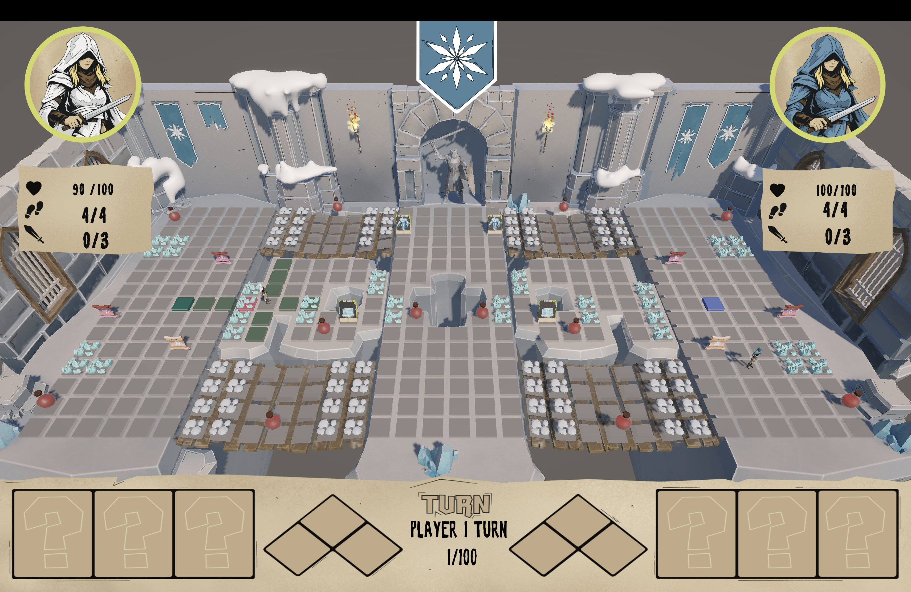

# AIBG - Monster Hunt Bot

A Python bot built during the 24-hour AIBG competition to play Monster Hunt, a turn-based arena game.

**3rd place out of 12 teams**, in a tournament with a group stage followed by knockout rounds.

## Strategy

The bot uses rule-based decisions and pathfinding to survive the shrinking arena and fight its opponent:

- Reach the central safe zone before the map shrinks.
- Collect useful items and monster cards when detours leave enough time to reach safety.
- Hold the safe zone, combining attacks, healing, freezing the opponent, and summoning monsters.

## Implementation

The bot combines pathfinding with heuristic-driven decisions based on the current game state. Movement planning accounts for obstacles and terrain costs, while tactical rules prioritize actions based on health, inventory, enemy position, and time remaining before the map shrinks.

## Team

- Mateja Jovanovic
- [Igor Janicevic](https://rs.linkedin.com/in/igor-janicevic-770075306/)
- [Ivan Janicevic](https://www.linkedin.com/in/janicevicivan/)
